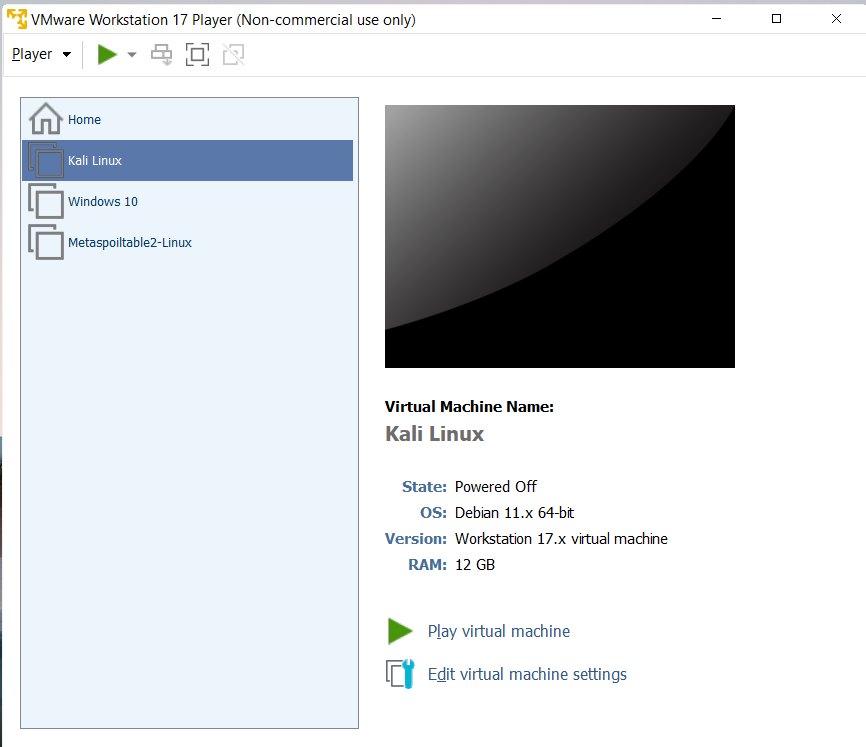
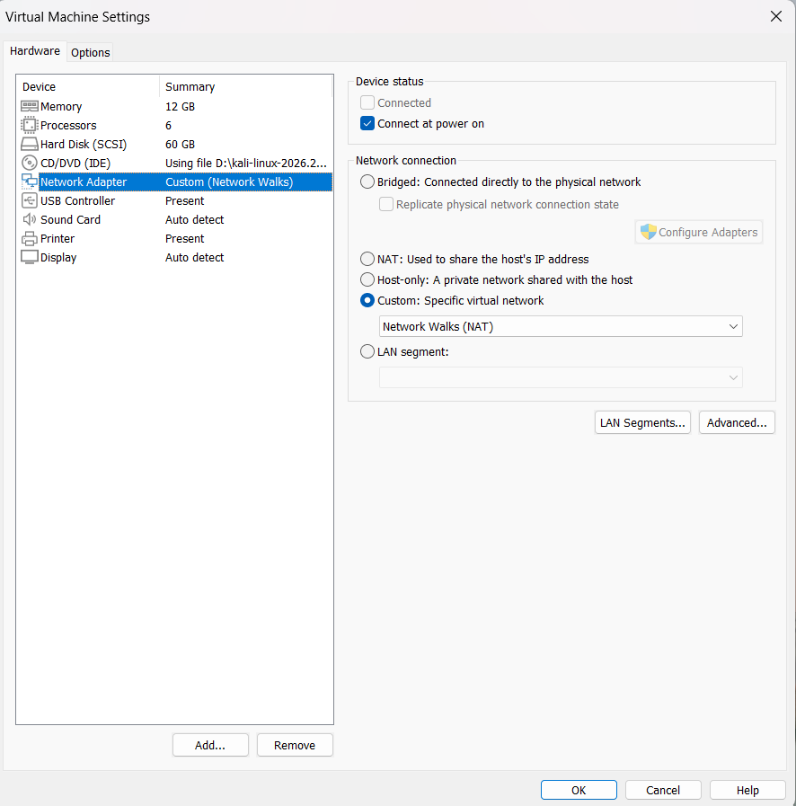
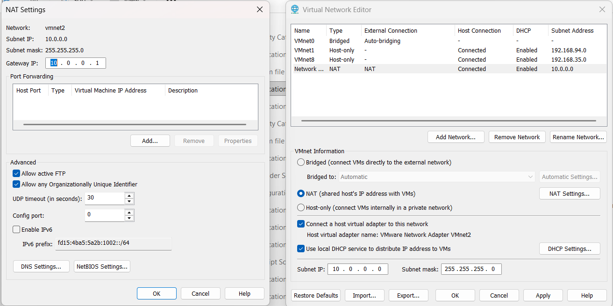
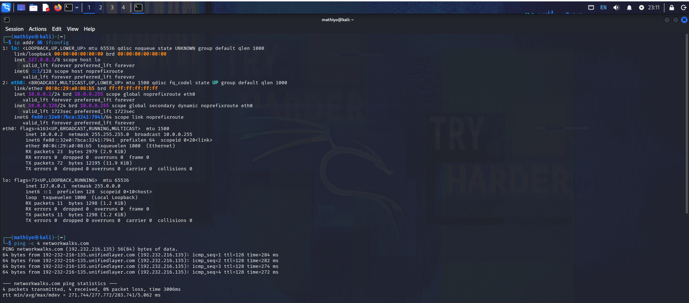

<div align="center">

# 🛡️ Cybersecurity Lab Environment Setup

### NetworkWalks Cybersecurity Program · Batch B084J · Week 01 · Project Module 1

A dedicated, NAT-based virtual lab built with **VMware Workstation 17 Player** and **Kali Linux**, configured and verified as a controlled environment for cybersecurity learning.


[](https://github.com/Monoranjan07)
[](https://www.linkedin.com/in/monoranjan-banik-3a0092335/)

</div>

---

## 📑 Table of Contents

1. [Project Overview](#-project-overview)
2. [Project Objectives](#-project-objectives)
3. [Purpose of the Lab](#-purpose-of-the-lab)
4. [Lab Architecture](#-lab-architecture)
5. [Lab Configuration](#-lab-configuration)
6. [Prerequisites and Tools Used](#-prerequisites-and-tools-used)
7. [Step-by-Step Lab Setup Procedure](#-step-by-step-lab-setup-procedure)
8. [Lab Verification](#-lab-verification)
9. [Project Demonstration Video](#-project-demonstration-video)
10. [Problems Encountered and Solutions](#-problems-encountered-and-solutions)
11. [What I Learned](#-what-i-learned)
12. [Security and Ethical Use](#-security-and-ethical-use)
13. [Tools and Resources](#-tools-and-resources)
14. [Author](#-author)
15. [Project Information](#-project-information)

---

## 📌 Project Overview

I configured a dedicated NAT-based virtual lab using **VMware Workstation 17 Player** and **Kali Linux** to establish a controlled environment for cybersecurity learning. The lab uses a custom virtual network (**VMnet2**, labelled *Network Walks (NAT)*) on the `10.0.0.0/24` subnet. The Kali Linux guest was attached to this network, assigned network settings, and verified for connectivity and DNS resolution.

This repository documents the configuration, the evidence (five original screenshots), and the verification results.

---

## 🎯 Project Objectives

- Install and use VMware Workstation 17 Player as the virtualization platform.
- Create an isolated, custom virtual network (VMnet2) using NAT.
- Allocate suitable resources to a Kali Linux virtual machine.
- Configure and understand Kali Linux IPv4 settings (address, gateway, DNS).
- Verify network connectivity and DNS resolution from inside the VM.
- Document the work clearly and reproducibly.

---

## 🧪 Purpose of the Lab

Security tools and techniques should be practised in a controlled environment rather than on live or unauthorised systems. This lab gives me:

- A **separate virtual network** that is distinct from my host's regular network adapter.
- A **Kali Linux** system that is ready for later learning exercises in the program.
- A **predictable addressing scheme** (`10.0.0.0/24`) that is easy to document and troubleshoot.
- A foundation for the upcoming modules of the NetworkWalks Cybersecurity Program.

---

## 🏗️ Lab Architecture

```text
┌──────────────────────────────────────────────────────────┐
│  Host computer (VMware Workstation 17 Player)            │
│                                                          │
│   ┌──────────────────────────────┐                       │
│   │  VMnet2 – "Network Walks"    │                       │
│   │  Type: NAT                   │                       │
│   │  Subnet: 10.0.0.0/24         │                       │
│   │  NAT gateway: 10.0.0.1       │                       │
│   │  DHCP: Enabled               │                       │
│   └──────────────┬───────────────┘                       │
│                  │                                       │
│        ┌─────────┴─────────┐                             │
│        │  Kali Linux VM    │                             │
│        │  eth0: 10.0.0.2/24│                             │
│        │  GW: 10.0.0.1     │                             │
│        │  DNS: 8.8.8.8     │                             │
│        └───────────────────┘                             │
└──────────────────────────────────────────────────────────┘
                   │  NAT
                   ▼
            External network / Internet
```

> The host operating system is not stated in my evidence, so it is intentionally not specified here.

---

## ⚙️ Lab Configuration

### Virtual Machine

| Setting | Value |
|---|---|
| Hypervisor | VMware Workstation 17 Player |
| Guest operating system | Kali Linux |
| Memory (RAM) | 12 GB |
| Processors | 6 |
| Virtual disk | 60 GB |
| Network adapter | Custom virtual network |
| Virtual network | Network Walks (NAT) – VMnet2 |

### VMware Virtual Network (VMnet2)

| Setting | Value |
|---|---|
| Network name | VMnet2 |
| Type | NAT |
| Subnet IP | 10.0.0.0 |
| Subnet mask | 255.255.255.0 |
| NAT gateway | 10.0.0.1 |
| DHCP | Enabled (VMware network settings) |

### Kali Linux Network Configuration

| Setting | Value |
|---|---|
| Interface | `eth0` |
| IPv4 method (GUI) | Automatic (DHCP) with an **additional static IPv4 address** |
| Primary IPv4 address | 10.0.0.2/24 |
| Additional address (dynamic) | 10.0.0.128/24 |
| Gateway | 10.0.0.1 |
| DNS | 8.8.8.8 |

**Accuracy note:** The IPv4 settings screenshot shows the method set to **Automatic (DHCP)**, with a static address (`10.0.0.2/24`) added alongside it. The terminal output shows both `10.0.0.2/24` and a second, dynamically assigned address `10.0.0.128/24` on `eth0`. This is therefore a **hybrid configuration**, not a purely manual one.

---

## 🧰 Prerequisites and Tools Used

| Tool / Requirement | Purpose |
|---|---|
| VMware Workstation 17 Player | Virtualization platform |
| Kali Linux virtual machine | Guest operating system for the lab |
| VMware Virtual Network Editor | Creating and configuring VMnet2 (NAT) |
| Kali network settings (GUI) | Reviewing and configuring IPv4 settings |
| Terminal: `ip addr`, `ifconfig`, `ping` | Inspecting addressing and testing connectivity |
| Sufficient host resources | The VM is allocated 12 GB RAM, 6 processors and a 60 GB disk |

---

## 🪜 Step-by-Step Lab Setup Procedure

### Step 1 — Prepare VMware Workstation 17 Player and the VM library

I used VMware Workstation 17 Player with the Kali Linux virtual machine listed in the library.

<p align="center">
  <br>
  <em>Figure 1 – VMware Workstation 17 Player showing the virtual machine library.</em>
</p>

### Step 2 — Configure the custom virtual network (VMnet2, NAT)

In the Virtual Network Editor, I configured **VMnet2** as a NAT network with subnet `10.0.0.0`, mask `255.255.255.0`, NAT gateway `10.0.0.1`, and DHCP enabled.

<p align="center">
  <br>
  <em>Figure 2 – VMware Virtual Network Editor with the VMnet2 NAT configuration.</em>
</p>

### Step 3 — Attach the Kali Linux VM to the custom network

I set the Kali Linux VM's network adapter to the **Custom** virtual network (*Network Walks (NAT)*), so the VM uses VMnet2 instead of the default network.

<p align="center">
  <br>
  <em>Figure 3 – Kali Linux VM network adapter set to the custom virtual network.</em>
</p>

### Step 4 — Review the IPv4 configuration inside Kali Linux

Inside Kali Linux, I reviewed the IPv4 settings for `eth0`: Automatic (DHCP) method with the static address `10.0.0.2/24`, gateway `10.0.0.1` and DNS `8.8.8.8`.

<p align="center">
  <br>
  <em>Figure 4 – Kali Linux IPv4 configuration (Automatic DHCP with an additional static address).</em>
</p>

### Step 5 — Verify addressing and connectivity

I confirmed the addresses with `ip addr` and `ifconfig`, then tested connectivity and DNS resolution with `ping`. See [Lab Verification](#-lab-verification).

<p align="center">
  <br>
  <em>Figure 5 – IP configuration and successful ping test from Kali Linux.</em>
</p>

---

## ✅ Lab Verification

### Completed checks (visible in the screenshots)

| Check | Command | Result |
|---|---|---|
| IP addressing | `ip addr` | `eth0` shows `10.0.0.2/24` and `10.0.0.128/24` |
| Interface details | `ifconfig` | Interface configuration displayed |
| Connectivity and DNS | `ping -c 4 networkwalks.com` | Domain resolved; 4 packets transmitted, 4 received, **0% packet loss** |

```bash
ip addr
ifconfig
ping -c 4 networkwalks.com
```

The successful ping to a domain name shows that the VM can reach the external network through the NAT gateway and that DNS resolution works.

### Recommended additional checks (not part of the completed evidence)

These are suggestions for further validation and are **not** claimed as completed:

```bash
ip route                      # confirm the default route via 10.0.0.1
cat /etc/resolv.conf          # confirm the DNS server in use
ping -c 4 10.0.0.1            # test the NAT gateway directly
ping -c 4 8.8.8.8             # test internet reachability without DNS
nslookup networkwalks.com     # test DNS resolution separately
```

---

## 🎬 Project Demonstration Video

[](https://www.linkedin.com/feed/update/urn:li:activity:7524479453679284225/)

**🔗 Video link:** https://www.linkedin.com/feed/update/urn:li:activity:7524479453679284225/

This LinkedIn video is my demonstration of the project. It covers the lab setup, including the VMware Workstation environment, the VMnet2 NAT network configuration, the Kali Linux network settings, and the connectivity verification.

---

## 🧩 Problems Encountered and Solutions

| Challenge | How I addressed it |
|---|---|
| **Two IPv4 addresses on `eth0`** (`10.0.0.2/24` and `10.0.0.128/24`) | I identified that the method was Automatic (DHCP) with an added static address. The static address is configured by me; the second address is dynamically assigned by VMware's DHCP service. |
| **Choosing the network type** | I used a dedicated NAT network (VMnet2) so the lab has its own subnet and addressing scheme, separate from other networks. |
| **Confirming real connectivity, not just an IP address** | I pinged a domain name (`networkwalks.com`) so a single test confirmed both routing through the gateway and DNS resolution. |

---

## 📚 What I Learned

- How to configure a custom virtual network in the VMware Virtual Network Editor.
- How a NAT network works, including the roles of the subnet, mask, gateway and DHCP.
- The difference between automatic (DHCP), static and hybrid IPv4 configurations.
- How to read `ip addr` and `ifconfig` output and recognise multiple addresses on one interface.
- How to verify connectivity and DNS resolution with `ping`.
- How to document a technical setup with clear evidence.

---

## ⚖️ Security and Ethical Use

- This lab is for **educational purposes** and learning in a controlled environment.
- Security tools must only be used on systems I own or have **explicit written permission** to test.
- No security testing against third-party systems is part of this project.
- Kali Linux includes powerful tools; they must be used lawfully and responsibly.

---

## 🔗 Tools and Resources

- [VMware Workstation Player](https://www.vmware.com/products/workstation-player.html)
- [Kali Linux](https://www.kali.org/)
- [Kali Linux Documentation](https://www.kali.org/docs/)
- [NetworkWalks](https://networkwalks.com)

---

## 👤 Author

### Monoranjan Banik

**Cybersecurity Intern – NetworkWalks Cybersecurity Program, Batch B084J**

[](https://github.com/Monoranjan07)
[](https://www.linkedin.com/in/monoranjan-banik-3a0092335/)

---

## 📋 Project Information

| Item | Details |
|---|---|
| **Project title** | Cybersecurity Lab Environment Setup |
| **Program** | NetworkWalks Cybersecurity Program |
| **Batch** | B084J |
| **Week** | 01 |
| **Module** | Project Module 1 – Cybersecurity Lab Setup |
| **Author** | Monoranjan Banik |
| **Repository** | [NETWORKWALKS-B084J-WK1-PM1-CYBERSECURITY-LAB-SETUP](https://github.com/Monoranjan07/NETWORKWALKS-B084J-WK1-PM1-CYBERSECURITY-LAB-SETUP) |
| **Demo video** | [Watch on LinkedIn](https://www.linkedin.com/feed/update/urn:li:activity:7524479453679284225/) |

<div align="center">

⭐ *Documented by Monoranjan Banik as part of the NetworkWalks Cybersecurity Program.*

</div>
